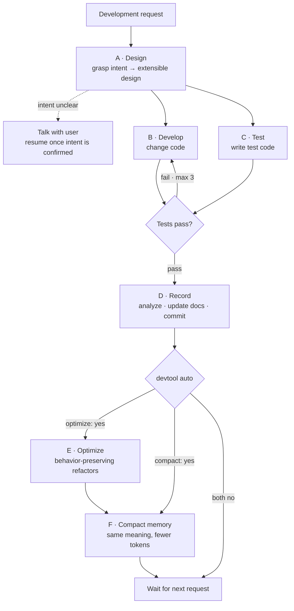
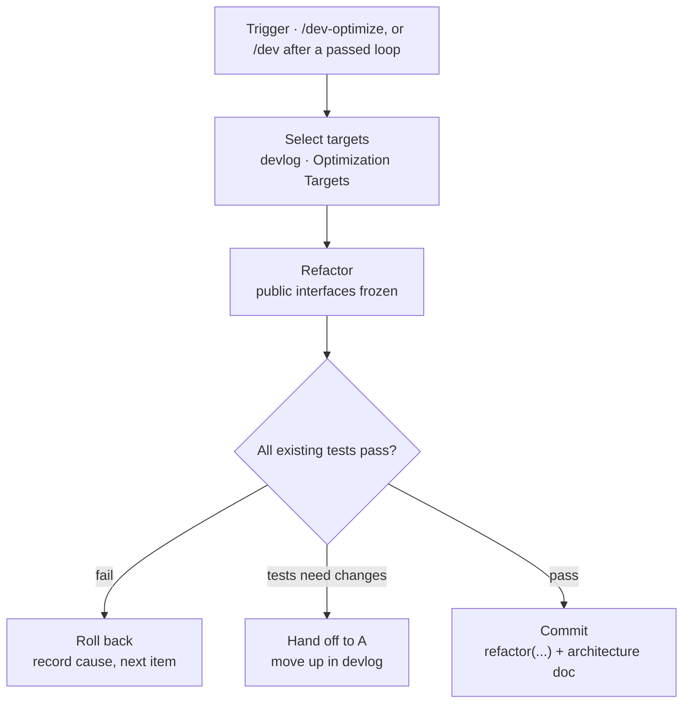

# Development Pipeline Design

2026-10-21

## Overview

This pipeline takes one development request around a full loop — design · implementation · testing · documentation · commit — then stops and waits for the next request.

It solves two problems: the design slowly eroding when requests are handled at face value, and working context living only in the conversation and vanishing by the next request.

At its core it is a single loop.

```
read context → order → execute → evaluate → limitations → update context → repeat
```

| Step | Meaning |
| --- | --- |
| Order | Grasp the underlying intent of the request and turn it into an extensible design |
| Execute | Change the code |
| Evaluate | Write and run tests |
| Limitations | Analyze the whole run and surface unresolved items |
| Update context | Update the spec documents + commit |

Five agents split these steps, each reading only its own share in an independent context; a sixth (F) keeps the context docs compact.

## Core principles

Three principles explain every other design decision.

**Limitations become the next order.** The loop's final output isn't code but a list of unresolved items. When the next request arrives, A reads this first and designs with it and the request together. This closes the loop and makes it a structure that can run even without outside requests.

**Documents are the state.** There is no separate context store. The files in `.dev/context/` are themselves the project's state; the loop starts by reading them and ends by updating them. Updating documents isn't a side task — it's what closes the loop.

**Context independence is token efficiency.** If agents share full conversation transcripts, cost grows quadratically as the loop gets longer. A splits its analysis into order files, and B · C · D read only their own. That's why they run independently.

## Directory structure

```
.dev/
├── context/                 persistent — the project's state
│   ├── 00-project.md         accounts · repos · environment (secrets by reference only, never values)
│   ├── 01-features.md        feature spec
│   ├── 02-design.md          visual design
│   ├── 03-architecture.md    code architecture
│   └── 04-devlog.md          development context (limitations / optimization targets)
└── loops/                   volatile — handoff between agents
    └── 2026-10-21-001/
        ├── order-B.md        A → B
        ├── order-C.md        A → C
        └── result.md         B diff summary + C test results
```

`loops/` is the key to token efficiency. Orders have to be split into files so each agent reads only its own. Only the last 10 are kept; the rest are deleted automatically. Their content survives as summaries in commit messages and the devlog.

## Document system

Specs are split along three axes. The rule: **if the reason to change differs, it's a different document.**

| Document | Question | Content | Changes when |
| --- | --- | --- | --- |
| 01-features | What can it do | use cases, inputs/outputs, state transitions, exceptions | what users want changes |
| 02-design | How does it look | layout, tokens, components, interactions | how it looks changes |
| 03-architecture | How does it work | module structure, data flow, dependencies, interfaces | how it's built changes |

**Boundary rule**: "it happens" is a feature, "it looks like this" is design, "it's built this way" is architecture. Items that straddle are split and written on each side.

**Cross-references**: tie IDs together like `F-012 ↔ D-07 ↔ U-23`. Without them, the three documents age separately and drift apart.

**04-devlog splits into two sections.** Routing diverges here, so always record them separately.

```markdown
## Limitations / Improvements   ← consumed by A (changes behavior)
- token refresh not implemented (F-031)
- no retry on upload failure

## Optimization Targets         ← consumed by E (behavior-preserving)
- duplicated validation logic in AuthProvider · SessionStore
- parseConfig() is 180 lines with 4 responsibilities
```

When unsure, send it up (to A). A second look by A is cheaper than E overstepping.

## Agents

Each agent has an independent context. They are implemented as subagents.

| | Role | Reads | Writes | Commits |
| --- | --- | --- | --- | --- |
| **A** | grasp intent → turn into extensible design, distribute work | full context + request | order-B, order-C | — |
| **B** | change code | order-B + target code | code | — |
| **C** | write tests → run → verdict | order-C | tests, result | — |
| **D** | analyze → surface limitations, update docs | order + result + context | full context | ✓ |
| **E** | refactor + update architecture doc | code + existing tests + devlog | code, 03-architecture | ✓ |

Only A reads the full context. It's the most expensive and most important step, so tokens are concentrated there while B · C are kept narrow.

**Permission boundaries**

- B cannot modify test code. Otherwise it bends the code to fit the tests.
- Only C may modify tests. C also gives the verdict.
- E doesn't touch 01-features · 02-design.
- Only D and E may commit.

## Main loop



C only needs A's acceptance criteria to write tests, so it doesn't wait for B. Tests standing first is what later lets E refactor safely.

**A starts the loop only when it's confident.** If the intent of a request isn't clear right away, it doesn't write orders and asks the user first. This isn't a design approval gate — it doesn't seek approval of a design, it confirms what is wanted, and once confirmed the loop runs to the end without human intervention.

There are three signals of ambiguity: the request branches into several designs, it conflicts with the existing spec, or its scope can't be written in one line.

## Retry constraints

Six limits keep the B↔C loop from spinning forever or burning tokens.

1. **Max 3 tries.** Stop when exhausted.
2. **Failures are passed as summaries only.** Failing test name + assertion diff + file:line. Never pass full logs.
3. **Same failure twice in a row → stop at once.** Circling the same spot isn't solved by retrying.
4. **B can't touch test code.** Only C may modify tests.
5. **C gives the verdict.** Tests come from A's acceptance criteria, so by default the tests are right.
6. **No commit when exhausted.** D records the cause of failure in 04-devlog, reports, and ends. The failure becomes context too, and A redesigns in the next loop.

## E · Optimization loop

E runs after a loop has committed — never concurrently with one (they touch the same code, so they're serialized).



**One rule: nothing observable from the outside changes.**

| E does | E doesn't |
| --- | --- |
| remove duplication | implement missing features |
| break up long functions · classes | add missing error handling |
| remove dead code | fix bugs |
| make naming consistent | change public API signatures |
| clean up unneeded dependencies | optimizations that change behavior, like adding a cache |
| remove redundant computation · N+1 | preemptive abstraction for extensibility |

There is one test. **If existing tests don't change by a single line, it's E; if they have to, it's not E.**

- No limit on the number of targets. Several optimization targets recorded in the devlog can be handled in one run. Unrecorded wholesale refactoring is still forbidden.
- No retries. Roll back immediately on failure.
- If it seems 01-features · 02-design need changes, it's out of scope.
- Triggered by `/dev-optimize`, or **automatically** by `/dev` after a passed loop when `devtool.py auto` reports 3+ targets or one marked `[high]` (complexity that already gets in the way: a function over ~150 lines, the same logic in 3+ places, a module with 4+ responsibilities). D only records targets; the orchestrator decides from the count, so the trigger doesn't depend on judgment.

## F · Memory compaction

A and D read all of `.dev/context/` on every loop, so the docs' size is paid on every request, and it grows with the project. F rewrites them shorter **without changing their meaning**: prose becomes terse bullets, repeated explanations merge, resolved text that is already superseded goes, and Loop Log rows beyond the latest 20 move verbatim to `.dev/archive/loop-log.md` (not read by the loop). It never drops or renumbers a spec ID, never merges two open devlog items, and keeps every heading.

`devtool.py memory-check` enforces this against HEAD — every spec ID (in context or archive), every heading and the open-item counts must survive, or F restores them or rolls back. The size after compaction is recorded in `.dev/memory.json`, and `/dev` runs F again only when the docs are over budget (~6000 tokens) **and** 25% larger than after the last compaction (or the Loop Log passes 20 rows) — so it doesn't churn on every loop. `/dev-optimize-memory` runs it on demand.

## Commit convention

**One loop = one commit.** Code + tests + docs are one unit. E makes one commit per item it handles, separated with the `refactor(...)` prefix.

```
feat(auth): add social login

Intent: reduce drop-off at sign-up (request: "add social login")
Design: abstracted behind an AuthProvider interface, extensible to OAuth providers
Changes: F-031 new / D-12 modified / U-08 new
Tests: 7 added, all passing
Limits: token refresh not implemented → devlog#14

loop: 2026-10-21-001
```

Pinning A's design intent in the message is the key. With the approval gate removed, this is the only place to trace afterwards "what A intended".

## Safeguards

There is no design approval gate. Instead, these safeguards fill its place.

| Safeguard | What it does |
| --- | --- |
| Ask when intent is unclear | If A isn't confident, it talks with the user first instead of writing orders |
| Stop on destructive changes | Schema migrations, mass deletions and major dependency upgrades stop and report |
| Loop serialization | Loops start only on a clean git working tree. Keeps E and the main loop from editing the same files at once |
| Match check | At the end of every loop, D leaves one line on "does the implementation match the request" |
| Design intent record | A's intent and the loop ID go into the commit message so the point of divergence can be traced |

When a mismatch is detected, A reads it first on the next request. The line of defense moves from before to after, but stays inside the loop.

## Automation mapping

| Mechanism | What it's given |
| --- | --- |
| CLAUDE.md | only what must hold in every session: when the loop runs, the language rule, a pointer to the skill |
| Skill | loop rules (doc boundaries, permissions, retries, stop conditions, commit format, housekeeping), spec templates, doc update checklist |
| Subagent | each of A–F — the implementation of context independence |
| Hook | enforce tests before commit, load 04-devlog at session start |
| Script | `devtool.py` — preflight, devlog sections, loop pruning, running tests with condensed output, and the numbers behind automatic E / F (`auto`, `memory`, `memory-check`) |
| Command | `/dev`, `/dev-optimize`, `/dev-optimize-memory`, `/dev-limitations` |

**Principle: always-needed rules in CLAUDE.md (kept short — it is read in every session and by every subagent), loop rules and procedures in skills, enforcement in hooks, isolation in subagents.**

Two layers: the global level lays down only the loop structure, and each project's CLAUDE.md fills in the specifics (test command, directory locations, language · framework). If a project has no CLAUDE.md, A scans the repo on the first run and generates one automatically.

## Caveats when adopting

**The first 3–5 loops are not hands-off.** If `01–03` are empty, A has no context to read and rescans all the code every time. For an existing project, it's better to spend the first loop on "documenting the current state in reverse".

**A being quietly wrong is the only real risk.** Mistakes by B · C · D show up in tests or diffs, but if A misreads the intent you get "a perfectly implemented wrong feature", and the tests pass too.

Settled decisions

| Item | Decision |
| --- | --- |
| `loops/` retention | last 10, the rest deleted automatically |
| Project CLAUDE.md | if missing, A scans the repo and generates it on the first run |
| Loop serialization | enforced by a clean git working tree check (no separate lock file) |
| E trigger | `/dev-optimize`, or automatic after a passed loop at 3+ targets or one `[high]` |
| F trigger | `/dev-optimize-memory`, or automatic after a passed loop when the context is over budget and has grown 25% since the last compaction |
