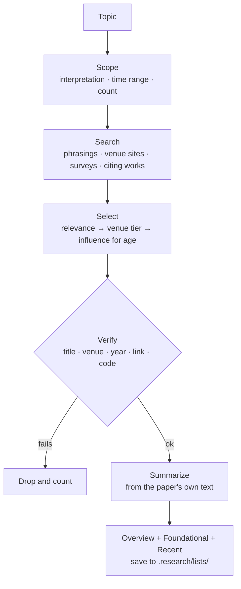
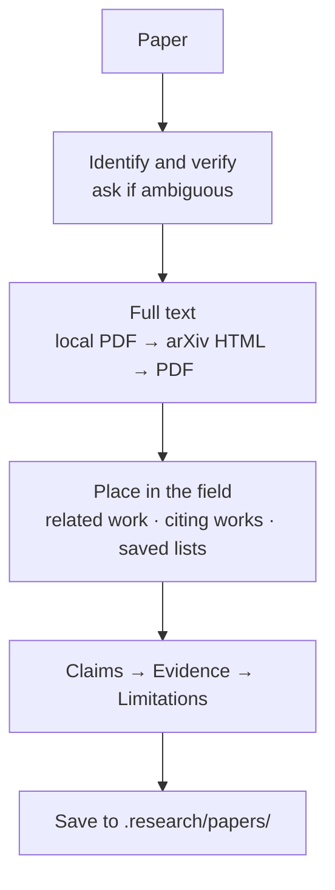

# Research Pipeline Design

2026-10-22

## Overview

Three commands for reading the literature with Claude Code: one finds the papers that matter on a topic, one takes a single paper apart, and one downloads a paper's PDF with a clean file name.

The problem both solve is trust. A literature answer is only useful if every paper in it is real, correctly attributed and worth reading, and if the analysis separates what the paper says from what the reader should think of it. So the pipeline is built around **trusted sources** and **verification before citation**.

| Command | Input | Output |
| --- | --- | --- |
| `/research-list-paper` | a topic or keywords | `.research/lists/<date>-<topic>.md` — the key papers, foundational and recent |
| `/research-summary-paper` | a title, arXiv ID, DOI or PDF | `.research/papers/<author><year>-<title>.md` — big picture, claims, evidence, limitations |
| `/research-download-paper` | a title, link, arXiv ID, DOI, or numbers from the last list | `<Downloads>/<year>. <title> (<venue>).pdf` |

## Principles

**Nothing unverified gets cited.** Every title, venue, year, link and code repo is confirmed from a fetched page before it appears. Search snippets and memory are for finding candidates, never for citing them. An entry that can't be verified is dropped, and the output says how many were dropped.

**Trusted venues first.** Peer-reviewed papers from established venues (CVPR, ICCV/ECCV, SIGGRAPH, NeurIPS, ICML, ICLR, IEEE journals, …) rank first. An arXiv-only paper is included only with a stated reason: adoption, the authors' track record, or a very recent result that already sets a direction.

**The paper's voice and ours stay apart.** Claims are attributed to the authors, with section and table references and exact numbers. Criticism is labeled as assessment and must point at something specific.

**Output in the user's language.** The kit is English; summaries and analyses follow the language of the request. Names of papers, venues, methods and datasets stay as published.

## /research-list-paper



Each entry is a table row: a slide-ready citation (`Kerbl et al., <Title> (SIGGRAPH 2023)`), links to the paper, the official code (or `—`) and a page that serves its BibTeX, why the paper is key, and a 2–3 sentence summary of the problem it tackles and how — or what it claims. An overview paragraph on top traces how the topic developed.

Defaults: 10–15 papers, split between foundational work and the last ~2 years. The request can change the range, the count or the focus.

## /research-download-paper

Resolves each paper to its published title, venue and year (same checks as a list entry), then saves the PDF to the user's Downloads folder as `<year>. <title> (<venue>).pdf` — e.g. `2024. SplaTAM - Splat, Track & Map 3D Gaussians for Dense RGB-D SLAM (CVPR).pdf`. The venue's camera-ready PDF comes first, arXiv is the fallback; only open, legitimate copies are used. A paywalled paper with no open copy is reported with its link instead.

## /research-summary-paper



| Section | Content |
| --- | --- |
| Big picture | the line of work it extends, the gap it targets, what came after (up to 10 follow-ups, grouped by direction) |
| Method in brief | how it works: inputs, core idea, outputs |
| Claims | what the authors claim, numbered, main contribution first; compound claims split |
| Evidence | per claim: assumptions, experiments (setup, numbers, ablations), proofs or explanations if any, and a one-line verdict |
| Limitations | acknowledged by the authors · gaps in the argument · room for improvement |
| Bottom line | what to take away and how much to trust it |

Two checks are built in because they find the real issues most often: each claim is compared with the conditions it was actually tested under, and headline numbers are checked against the detailed tables.

If the full text or a linked supplement isn't available, the analysis says so at the top and stays within what was actually read. The chat shows only the bottom line and the verdicts; the full analysis is in the file.

## Verification levels

| Level | Applies to | Requires |
| --- | --- | --- |
| Full check | each paper in a list; the paper being analyzed | title from the paper's page, venue + year from the venue's own record or DOI, a working link, official code confirmed |
| Light check | papers mentioned in passing (e.g. follow-ups) | one metadata record (OpenAlex, Crossref, Semantic Scholar or arXiv) |

Anything that rests on a weaker source or couldn't be reached is written in the output's source note rather than silently asserted.

## Sources

Lookups run through `researchtool.py` in the skill's `scripts/` folder — search, metadata, citing works, venue pages, GitHub, BibTeX links and full text — so each run prints only what's needed instead of raw pages.

The skill `research-sources` holds the shared rules: venue tiers, arXiv-only criteria, the verification table, link priority and lookup services. Every command reads it first.

Discovery uses web search. Verification uses arXiv, Crossref, OpenAlex and Semantic Scholar APIs plus the venue sites (CVF Open Access, OpenReview, PMLR, NeurIPS proceedings, ACM DL). All work without keys; if `SEMANTIC_SCHOLAR_API_KEY` or `OPENALEX_API_KEY` is set, it is used. The pipeline never signs up for keys or sends the user's details anywhere.

## Files

```
<project>/
├── CLAUDE.md                          research block (marker) — commands, language, integrity
├── .claude/
│   ├── commands/
│   │   ├── research-list-paper.md
│   │   ├── research-summary-paper.md
│   │   └── research-download-paper.md
│   └── skills/research-sources/       source & verification rules + scripts/researchtool.py
└── .research/
    ├── lists/                         /research-list-paper output
    └── papers/                        /research-summary-paper output
```

`/research-summary-paper` reads `.research/lists/` when placing a paper in its field, so earlier lists make later analyses better informed.
